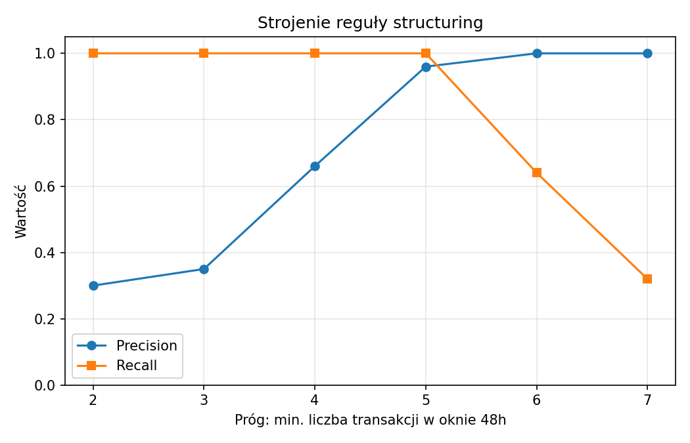

# Transaction Monitoring Rule Simulator

Simulation of a structuring detection rule on synthetic transaction data,
showing how threshold tuning affects false positives and detection rate.

## Problem
Structuring (splitting amounts just below a reporting threshold) is a classic
money laundering pattern. Rules that are too sensitive flood analysts with
false positives; rules that are too strict miss real cases.

## Data
Fully synthetic: 20,000 normal transactions, 153 injected structuring
transactions (25 customers) and 1,500 legitimate large payments near the
threshold acting as noise. No real data was used.

## Method
Rule: flag a customer with at least N transactions between 9,000 and 10,000
within a 48-hour window. N tested from 2 to 7; precision and recall computed
against the known injected cases.

## Results
Threshold 5 gives the best trade-off: 25 of 25 cases detected with 1 false
positive. Threshold 2 produces 57 false positives; threshold 6 misses 36% of cases.

## Limitations
Synthetic data is simpler than real customer behavior. Fixed amount band and
window; no customer-segment-specific thresholds.

## How to run
Open transaction_monitoring_simulator.ipynb in Google Colab and run all cells.
